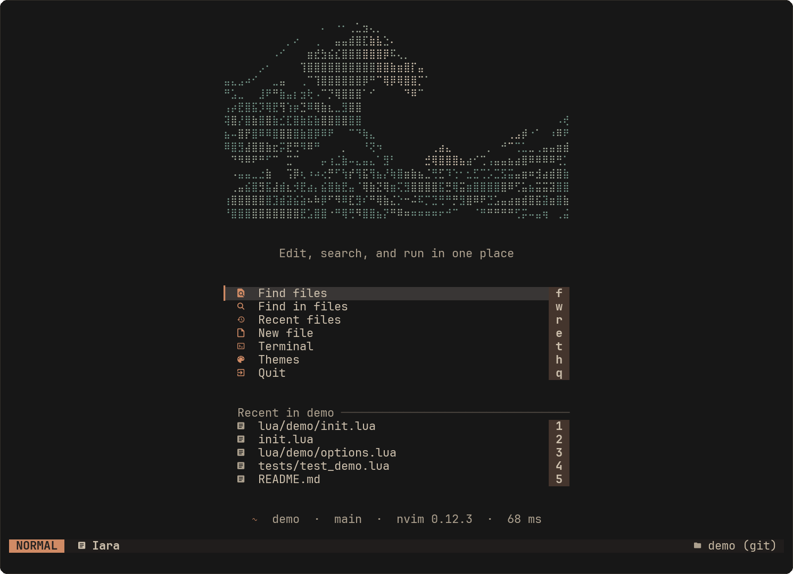

# Iara



Iara is a Neovim distribution with project search, a dockable terminal,
and keyboard shortcuts for navigating code and structured data. Codex
and Claude Code are optional.

## Install

Requires Linux, Neovim 0.12.3 or newer, Git 2.19 or newer, GNU Make,
`curl`, `tar`, `rg`, and a C compiler. Use a Nerd Font for the UI icons.

From this checkout:

```sh
make install
iara
```

The launcher lives in `~/.local/bin` by default. Iara has its own
configuration and data under `NVIM_APPNAME=iara`. Run
`:checkhealth iara` to check your setup.

`make update` builds a release from this checkout and carries your
personal settings forward. `make rollback` switches to the previous
release. See the [user guide](GUIDE.md#installation) for installation
options and recovery.

## Features

- Find files with `Space ff` and search their contents with `Space fw`.
  Narrow by directory or glob, preview matches, and send them to quickfix.
- Browse the current file's directory in Oil with `Space d`.
- Open a PDF with `:IaraPDF path/to/file.pdf` and scroll with `j` and `k`.
- Toggle the project shell with `F7`. Move it to an edge or float it
  while the shell keeps running.
- Inspect JSON and YAML paths at the cursor and search keys.
- Open Codex with `Space ax` or Claude Code with `Space ac`. In Visual mode,
  `Space ai` asks about the selection and uses Codex by default.
- Preview themes with `Space th`. Switch between terminal and theme
  backgrounds with `:IaraToggleBackground`.

The leader is `Space`. Press `Space wK` to list mappings, or see the
[command and key reference](GUIDE.md#mappings-and-commands).

## Configuration

Put a Lua table in `~/.config/iara/lua/user.lua`, or set `IARA_PERSONAL`
to the path of your configuration file.

```lua
return {
  ui = { theme = "gruvbox", wave_animation = false },
  options = { relativenumber = true },
}
```

Use `:TSInstall` to add Tree-sitter languages. The
[configuration guide](GUIDE.md#configuration) covers keymaps, plugins,
and trusted project settings.

## Development

```sh
make tools
make check
make dev
```

`make dev` uses an isolated profile. See the
[development guide](GUIDE.md#development) for Luacheck, CI, and pre-commit.
The adapted palettes are credited in [third-party notices](THIRD_PARTY.md).
